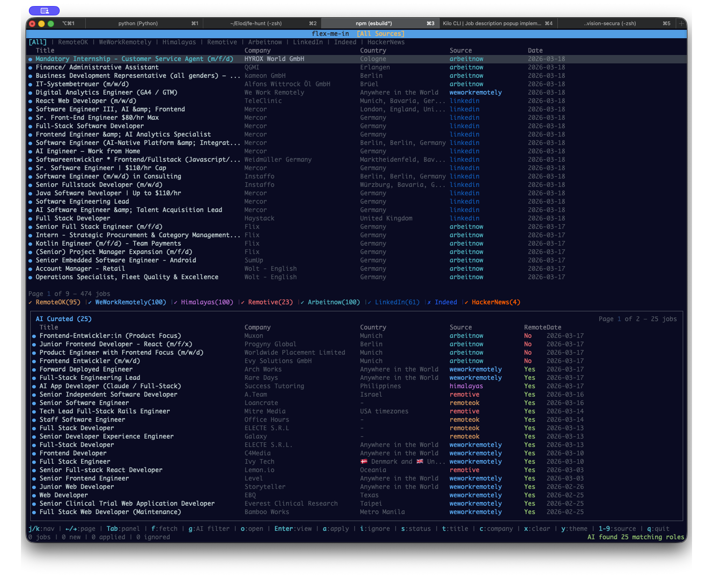

# flex-me-in

<p align="center">
  <a href="https://github.com/elodlukacs/flex-me-in/blob/main/LICENSE">
    
  </a>
  <a href="https://github.com/elodlukacs/flex-me-in/stargazers">
    
  </a>
  <a href="https://github.com/elodlukacs/flex-me-in/fork">
    
  </a>
</p>

A terminal TUI that aggregates **senior frontend developer** roles from remote job boards. Every source is filtered at ingest — by title, at the API where the source supports it — so the list only ever contains Senior/Lead/Staff/Principal frontend, React, Vue, Angular, Svelte, Next.js, TypeScript, UI and Web engineering roles.



## Features

- **Senior-frontend only**: A shared title gate (`src/api/relevance.ts`) drops junior/mid, backend, mobile, data and non-engineering roles before they reach the DB
- **Multiple Job Sources**: 8 remote job boards, EMEA-weighted
- **AI-Powered Filtering**: Optional second pass via DeepSeek to rank remote-friendliness
- **Local Database**: Stores jobs locally using SQLite for fast access and persistence
- **Rich Filtering**: Filter by status, source, work type, title, company, and country
- **Job Descriptions**: View full job descriptions in a popup without leaving the terminal
- **Keyboard-Driven**: Full keyboard navigation for power users
- **Multiple Themes**: Choose from several color themes
- **Status Tracking**: Track jobs as new, saved (for later), applied, or ignored. New means
  "arrived in that board's latest refresh": the next refresh hands the label to whatever it
  brings, and untouched older jobs are left with no status. Opening a job (link or details)
  also takes New away and greys it out; never-opened jobs carry a dot in the TUI
- **Last refresh**: shown in Romania time in the TUI title bar and the app header

## Supported Job Boards

| Source | How it is narrowed | Descriptions |
|---|---|---|
| LinkedIn | Guest search, remote-only (`f_WT=2`): 7 keywords across Europe (past 24 h, then 7 days), then the broad keywords per country across 11 EMEA geoIds, plus the title gate | no |
| Workable | Cross-company meta board, `query=frontend` / `front end` / `react` with `workplace=remote`, every page, EMEA-gated on any listed country | yes |
| Himalayas | Search API, `q=frontend&seniority=Senior`, gated on the countries a hire may live in | yes |
| Jobicy | `geo=europe`, `tag=frontend` plus the whole `industry=dev` feed, remote-only board | yes |
| JustJoin.IT | API filtered to frontend category + senior + remote | no |
| RemoteOK | `?tags=front-end` feed, plus the title gate | yes |
| We Work Remotely | All-jobs and full-stack RSS, plus the title gate | yes |
| Remotive | software-dev feed, plus the title gate | yes |

LinkedIn is the slow one: about 4 minutes at a polite request rate, capped at
200 requests a run. A run that reaches the cap keeps older LinkedIn rows rather
than purging them; untriaged rows still expire after 30 days.

Yield varies a lot by day and by source. LinkedIn and Workable carry most of the
senior EMEA supply; RemoteOK, We Work Remotely and Remotive frequently have zero
senior frontend postings at all. **An empty source is normal, not a failure** —
the status bar reports which sources failed versus which simply had nothing.

Workable lists one role once per hiring country. Those duplicates are collapsed
into a single row with the countries merged (`collapseByRole` in
`src/api/common.ts`), so marking a role applied covers every country it was
posted in.

## Quick Start

### Prerequisites

- Node.js 20+ (required by better-sqlite3)
- npm or yarn

### Installation

```bash
# Clone the repository
git clone https://github.com/elodlukacs/flex-me-in.git
cd flex-me-in

# Install dependencies
npm install

# Build the application
npm run build

# Run in development mode
npm run dev

# Or run the built version
npm start

# Run the tests (Vitest) and the type checker
npm test
npm run typecheck
```

### Global Installation

```bash
# Build and install globally
npm run build
npm link

# Now you can run from anywhere
flex-me-in
```

## Usage

### Basic Commands

| Key | Action |
|-----|--------|
| `f` | Fetch jobs from all sources |
| `F` | Fetch only the active source tab |
| `j/k` or `↓/↑` | Navigate up/down |
| `←/→` or `PgUp/PgDn` | Previous/Next page |
| `Enter` | View job description (marks it opened) |
| `Esc/q` | Close popup |
| `o` | Open job URL in browser (marks it opened) |
| `a` | Toggle applied status |
| `l` | Toggle saved for later |
| `i` | Toggle ignored status |
| `s` | Cycle status filter |
| `n` | Clear the status |
| `Ctrl+S` | Cancel a running fetch |

### Filtering

| Key | Action |
|-----|--------|
| `t` | Filter by title |
| `c` | Filter by company |
| `m` | Filter by country |
| `w` | Cycle work type filter |
| `u` | Cycle the source tab |
| `x` | Clear all filters |

### AI & Views

| Key | Action |
|-----|--------|
| `g` | Run AI filter (remote detection) |
| `G` | Clear AI results and close the panel |
| `Tab` | Toggle between main list and AI panel |
| `1-9` | Switch source tab (All, RemoteOK, WWR, Remotive, LinkedIn, JustJoin.IT, Workable, Jobicy, Himalayas) |

### Other

| Key | Action |
|-----|--------|
| `y` | Change theme |
| `?` | Full keybinding list |
| `Ctrl+D` | Delete every stored job (asks for `y` to confirm) |
| `q` | Quit, or close the open overlay |

## Configuration

### Environment Variables

Put your settings in `~/.flex-me-in/.env`, as shown below.
That file is read wherever you start the app from, so it also works for a global
`npm link` install. A `.env` in the current directory is read too; when both set
a variable, `~/.flex-me-in/.env` wins, and real environment variables win over both.

```env
# DeepSeek API key for AI filtering (optional — everything else works without it)
DEEPSEEK_API_KEY=your_api_key_here   # https://platform.deepseek.com
# Optional model override; defaults to deepseek-flash
DEEPSEEK_MODEL=deepseek-flash
```

### Data Storage

Jobs are stored in `~/.flex-me-in/jobs.db`
Configuration is stored in `~/.flex-me-in/config.json`
Fetch/parse diagnostics are appended to `~/.flex-me-in/error.log` (private to
your user, API keys redacted, rotated at 1 MB). The TUI owns the screen, so
nothing is printed while it runs; a fatal startup error (for example a
better-sqlite3 build that doesn't match your Node version) is printed once on exit.

## Tech Stack

- **React** - UI framework
- **Ink** - Terminal UI library for React
- **TypeScript** - Type-safe JavaScript
- **SQLite** - Local database (better-sqlite3)
- **DeepSeek** - AI-powered job filtering
- **tsup** - TypeScript bundler

## Project Structure

```
src/
├── api/              # API clients for job sources
├── components/      # React components
│   ├── filters/     # Filter UI components
│   ├── jobs/        # Job listing components
│   ├── fetch/       # Fetch progress components
│   └── layout/      # Layout components
├── db/              # Database operations
├── hooks/           # Custom React hooks
├── state/           # Store, reducer, selectors, types
├── utils/           # Formatting, theme, logging, env loading
└── app/             # Main app components
```

## Contributing

Contributions are welcome!

1. Fork the repository
2. Create your feature branch (`git checkout -b feature/amazing-feature`)
3. Commit your changes (`git commit -m 'feat: add amazing feature'`)
4. Make sure `npm test` and `npm run typecheck` pass
5. Push to the branch (`git push origin feature/amazing-feature`)
6. Open a Pull Request

## License

Distributed under the MIT License. See [LICENSE](LICENSE) for more information.

## Acknowledgments

- [Ink](https://github.com/vadimdemedes/ink) - Terminal UI framework
- [RemoteOK](https://remoteok.com/) - Remote job listings
- [We Work Remotely](https://weworkremotely.com/) - Remote job listings
- [DeepSeek](https://www.deepseek.com/) - AI for job filtering
